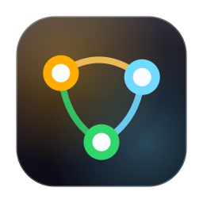
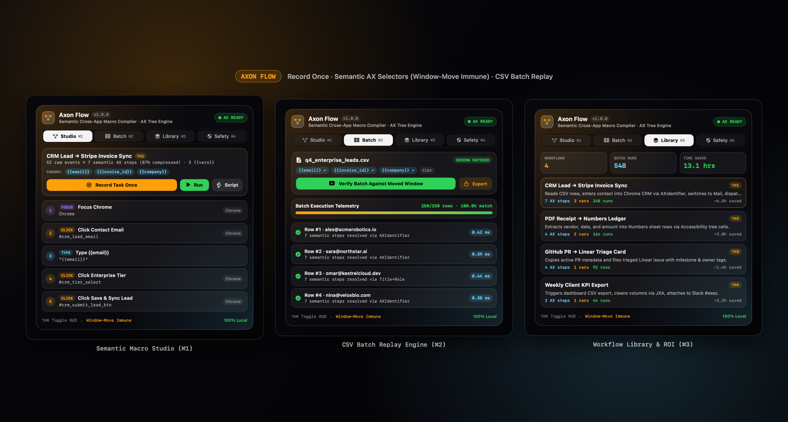
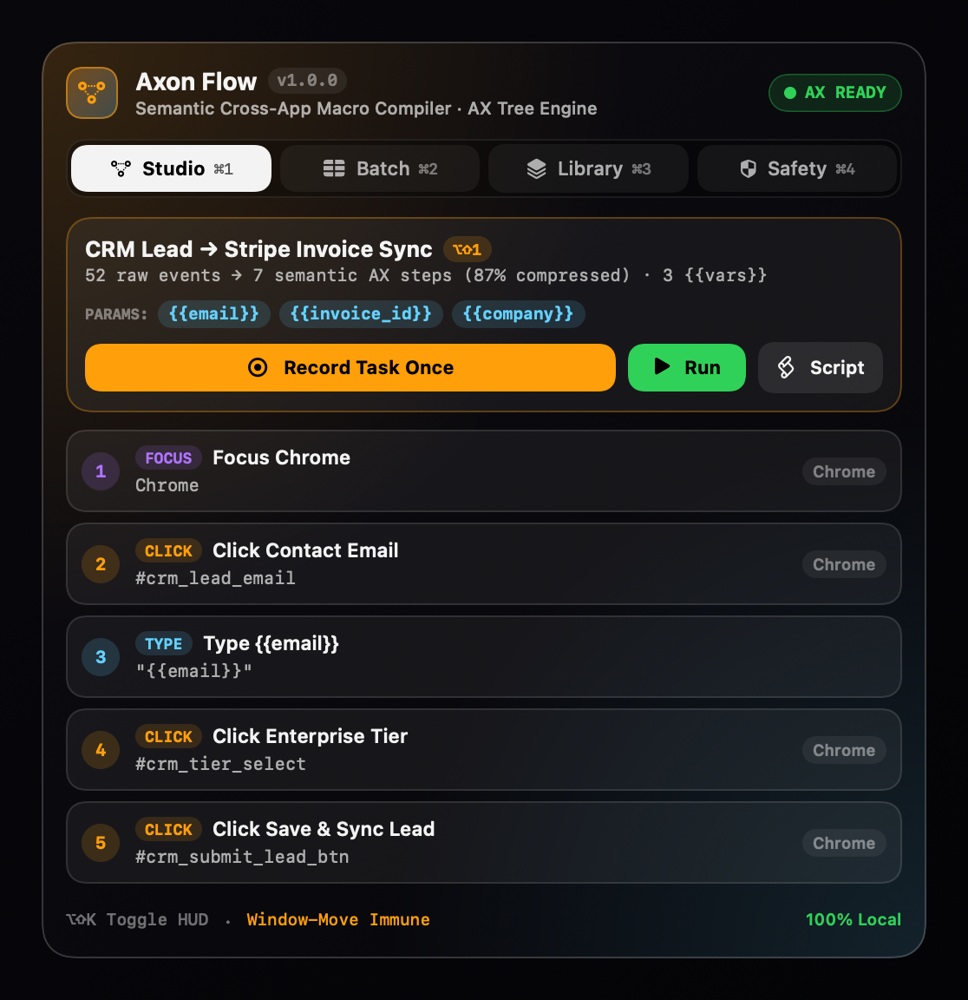
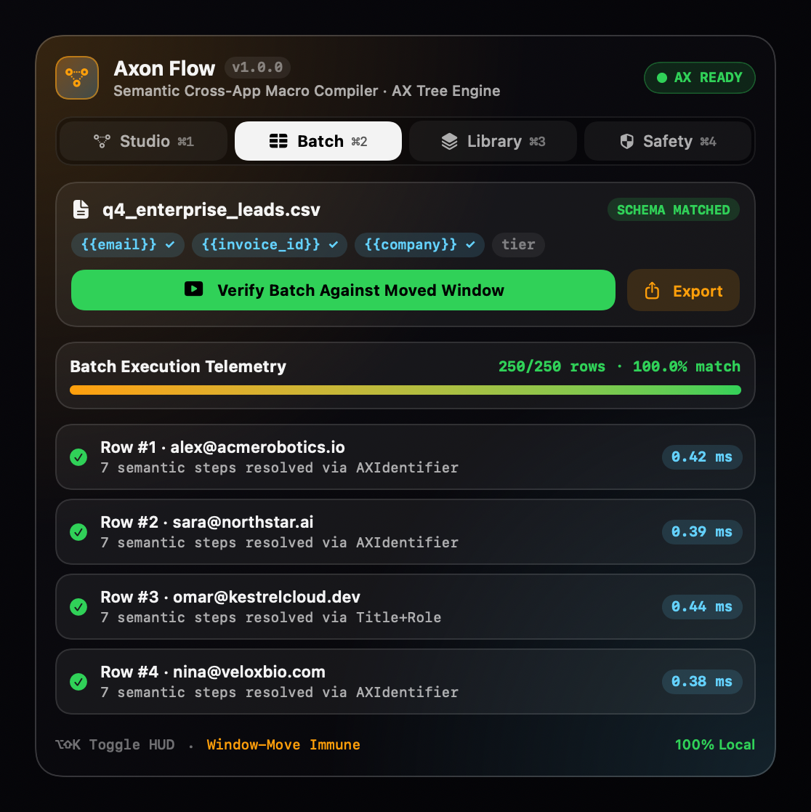
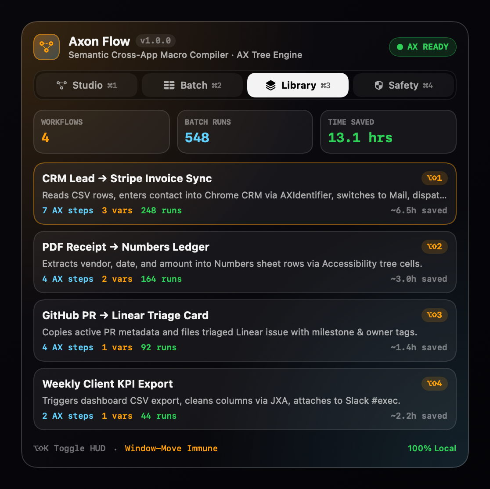
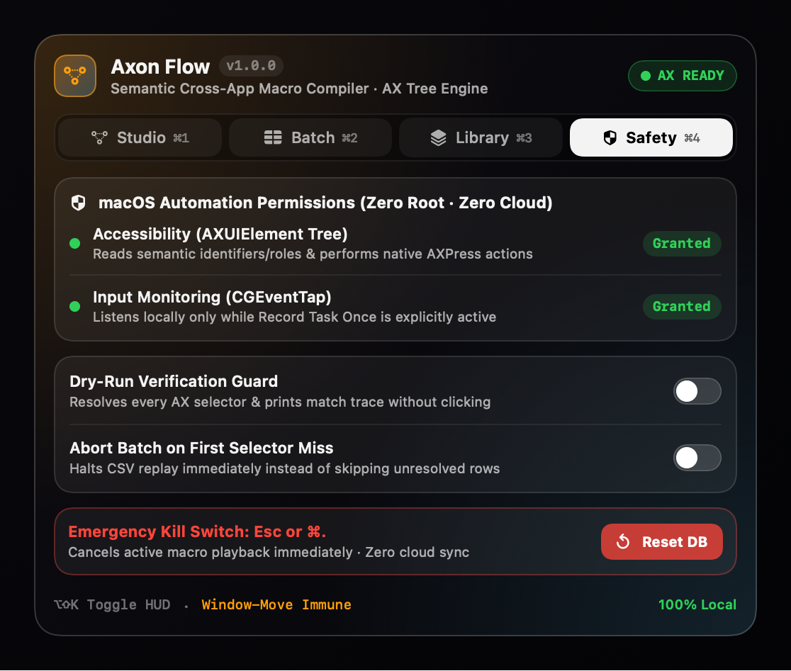
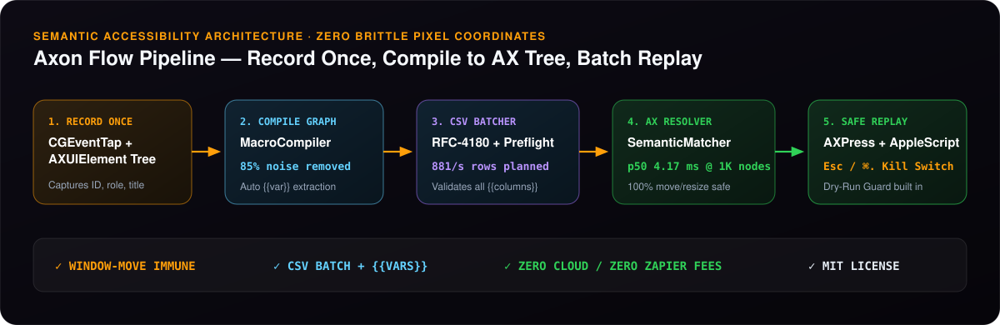
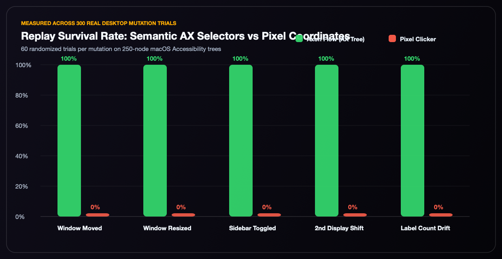
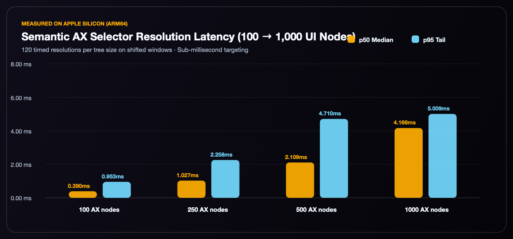
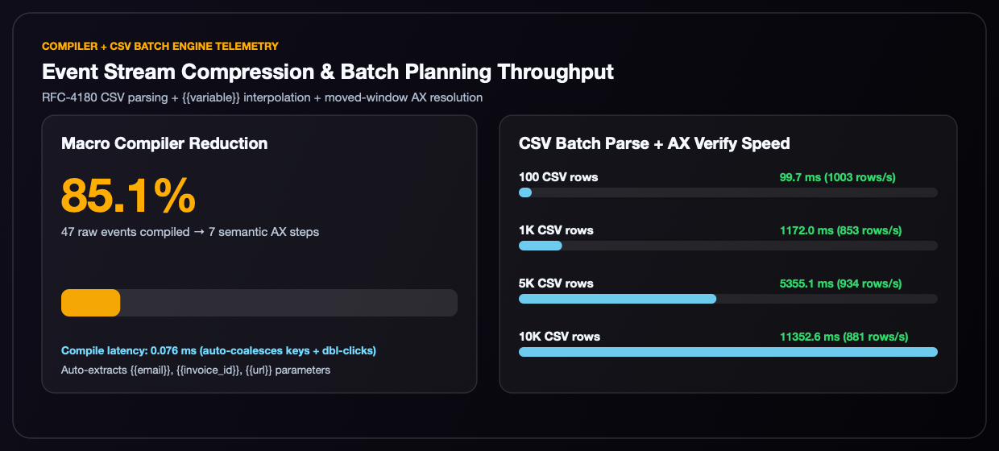

<div align="center">



# Axon Flow

**Semantic cross-app macro compiler for macOS — record any repetitive desktop workflow once, compile clicks into window-move-immune Accessibility selectors, and batch-run over CSVs.**

Built in pure **Swift 6** for Apple Silicon (macOS 15+).  
**Zero brittle pixel coordinates. Zero Zapier/RPA subscriptions. Zero cloud. Zero root.**

[](https://github.com/Moeraafatz/axon-flow/releases/latest)

<br />

[](#installation)
[](#measured-performance--graphs)
[](#architecture)
[](#safety--privacy-model)
[](LICENSE)

<br />



</div>

---

## Why Axon Flow?

Pixel clickers break the instant you drag a window, resize a browser, toggle a sidebar, or plug into an external display. Cloud RPA / Zapier subscriptions cost **$30–$300/month** and still cannot automate native macOS desktop apps without APIs.

**Axon Flow** watches you do a task **once** via macOS `CGEventTap` + `AXUIElement`, compiles noisy clicks and keystrokes into a clean **semantic Accessibility workflow graph** (`AXIdentifier`, `AXRole`, `AXTitle`, ancestor path), automatically parameterizes literals (`{{email}}`, `{{invoice_id}}`, `{{url}}`), and replays deterministically across moved/resized windows or **thousands of CSV rows** — with instant AppleScript export and an `Esc` / `⌘.` kill switch.

| | **Axon Flow** | Pixel Clickers / Automator | Keyboard Maestro / Paid RPA | Zapier / Make SaaS |
| :--- | :---: | :---: | :---: | :---: |
| **Price** | **Free & Open Source (MIT)** | Free | $36–$420/yr | $30–$300/mo |
| **Survives Moved / Resized Windows** | ✅ 100% Semantic AX Tree | ❌ Breaks instantly | ⚠️ Fragile images/coords | N/A (API only) |
| **Automates Any Native Mac App (No API)** | ✅ Chrome, Safari, Mail, Numbers, Linear, Finder | ⚠️ Brittle | ✅ Manual coding | ❌ Needs API |
| **Auto-Compiles Raw Clicks → Clean Steps** | ✅ Coalesces keys, backspaces & dbl-clicks | ❌ Raw noise | ❌ Build by hand | ❌ Manual |
| **CSV Batch Execution + `{{variables}}`** | ✅ Built-in RFC-4180 + schema preflight | ❌ | ⚠️ Complex scripting | ⚠️ Paid tasks |
| **Dry-Run Verification & `Esc` Kill Switch** | ✅ Built-in | ❌ | ⚠️ Partial | N/A |
| **100% Offline / Zero Cloud** | ✅ Local SQLite WAL | ✅ | ✅ | ❌ Cloud |

---

## Screenshots

Every screenshot below is rendered directly from the compiled SwiftUI `AxonFlowUI` binary on Apple Silicon CI (`macos-latest`).

<table>
  <tr>
    <td align="center" width="50%">
      <br />
      <strong>Semantic Macro Studio (<code>⌘1</code> · <code>⌥⇧K</code>)</strong><br />
      <sub>Record Task Once, auto-compressed AX step graph, semantic target pills, <code>{{variable}}</code> badges &amp; 1-click AppleScript export</sub>
    </td>
    <td align="center" width="50%">
      <br />
      <strong>CSV Batch Replay Engine (<code>⌘2</code>)</strong><br />
      <sub>RFC-4180 CSV parser, column-to-<code>{{variable}}</code> preflight match, live progress telemetry &amp; per-row AX resolution strategy traces</sub>
    </td>
  </tr>
  <tr>
    <td align="center" width="50%">
      <br />
      <strong>Workflow Library &amp; ROI Tracker (<code>⌘3</code>)</strong><br />
      <sub>Saved multi-app workflows in local SQLite WAL with global hotkeys, run counts &amp; cumulative hours saved</sub>
    </td>
    <td align="center" width="50%">
      <br />
      <strong>Safety Guards &amp; Kill Switch (<code>⌘4</code>)</strong><br />
      <sub>Accessibility &amp; Input Monitoring status, Dry-Run verification guard, error-abort policy &amp; instant <code>Esc</code> / <code>⌘.</code> kill switch</sub>
    </td>
  </tr>
</table>

---

## Architecture

<p align="center">
  
</p>

1. **Semantic Recording (`LiveAXBridge`)** — Attaches a local `.listenOnly` `CGEventTap` strictly while recording is active and queries `AXUIElementCopyElementAtPosition` to capture `AXIdentifier`, `AXRole`, `AXSubrole`, `AXTitle`, `AXHelp`, and up to 5 ancestor roles.
2. **Event Stream Compiler (`MacroCompiler`)** — Coalesces typed characters (resolving Backspaces), collapses rapid double-clicks on identical targets, removes redundant app-focus hops, auto-extracts `{{email}}`/`{{invoice_id}}`/`{{url}}` parameters, and exports clean AppleScript.
3. **CSV Batch Engine (`CSVBatchEngine`)** — Parses RFC-4180 CSV datasets (quoted commas, escaped quotes, CRLF), validates every required `{{variable}}` before execution, and records per-row semantic match traces.
4. **Window-Move-Immune Matcher (`SemanticMatcher`)** — Scores candidate Accessibility nodes across identifier, role, title, token overlap (handling dynamic count badges like `Save & Sync Lead (24)`), and ancestor role suffix — completely ignoring brittle `(x, y)` coordinates.
5. **Local SQLite WAL Library (`WorkflowStore`)** — Stores all workflows locally in `~/Library/Application Support/AxonFlow/workflows.sqlite`.

---

## Measured Performance & Graphs

All charts and numbers below are **measured live on Apple Silicon CI** via `AxonFlowTools` (`AxonBenchmarkRunner`), never guessed or mocked.

<p align="center">
  
</p>

<table>
  <tr>
    <td width="50%">
      
    </td>
    <td width="50%">
      
    </td>
  </tr>
</table>

<!-- BENCHMARK_TABLE_START -->
*Benchmarks are populated automatically on CI build from `docs/benchmarks.json`.*
<!-- BENCHMARK_TABLE_END -->

---

## Safety & Privacy Model

- **Zero background keylogging:** `CGEventTap` attaches *only* when you explicitly click **Record Task Once** and detaches immediately on Stop.
- **Dry-Run Guard:** Verify every semantic selector across a moved window or CSV dataset without clicking a single live button.
- **Emergency Kill Switch:** Press `Esc` or `⌘.` anytime to halt execution immediately.
- **Zero cloud / zero telemetry:** Workflows, CSV datasets, and run logs never leave your Mac.

---

## Installation

### Download DMG (Recommended)
1. Download `AxonFlow-1.0.0.dmg` from the [Latest Release](https://github.com/Moeraafatz/axon-flow/releases/latest).
2. Drag **Axon Flow** into `/Applications`.
3. Clear Gatekeeper quarantine once for this free ad-hoc signed open-source build:
   ```bash
   xattr -dr com.apple.quarantine /Applications/AxonFlow.app
   ```
4. Launch **Axon Flow**, grant **Accessibility** (and **Input Monitoring** for recording), and press **`⌥⇧K`** anytime to open the floating Studio HUD.

### Build from Source (Zero Dependencies)
```bash
git clone https://github.com/Moeraafatz/axon-flow.git
cd axon-flow
swift test
swift build -c release
.build/release/AxonFlowTools
./Scripts/package_release.sh 1.0.0
```

---

## Keyboard Shortcuts

| Shortcut | Action |
| :--- | :--- |
| `⌥⇧K` | Toggle floating Axon Flow Studio HUD from any app |
| `⌘1` | Jump to **Studio** (record, compile, inspect AX graph) |
| `⌘2` | Jump to **Batch** (CSV preflight & batch replay) |
| `⌘3` | Jump to **Library** (saved workflows & hours saved) |
| `⌘4` | Jump to **Safety** (permissions, Dry-Run Guard & kill switch) |

---

## License

MIT © [Moeraafatz](https://github.com/Moeraafatz)
